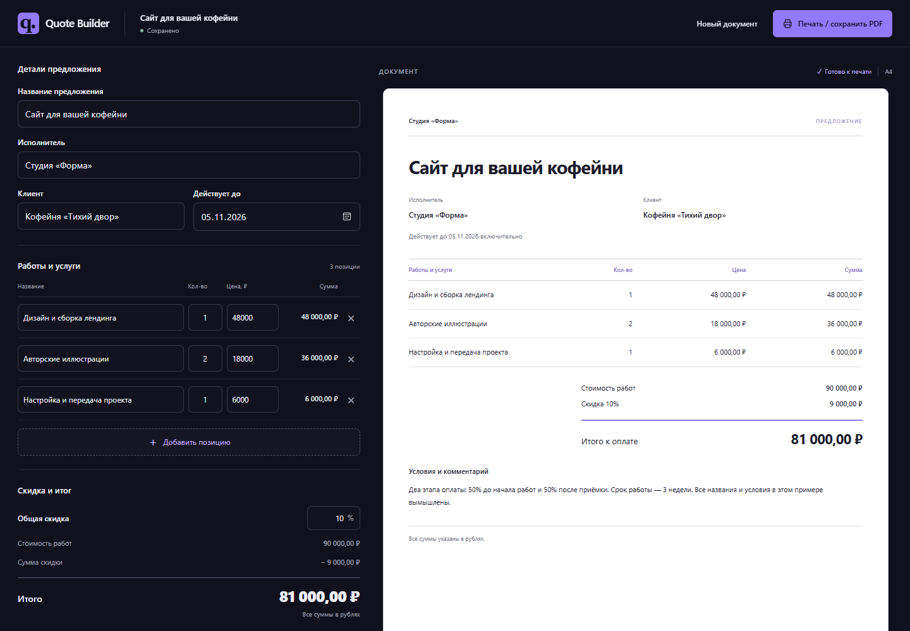
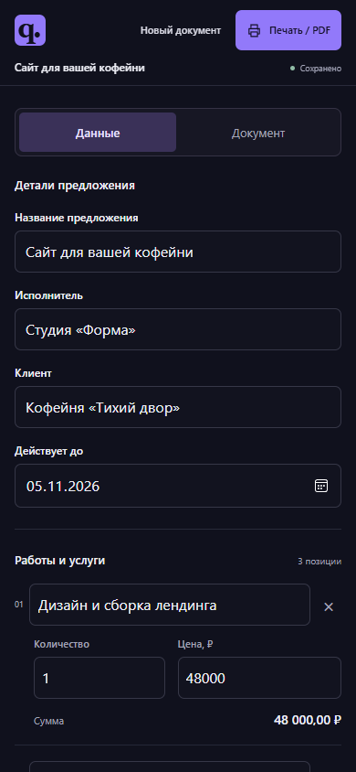
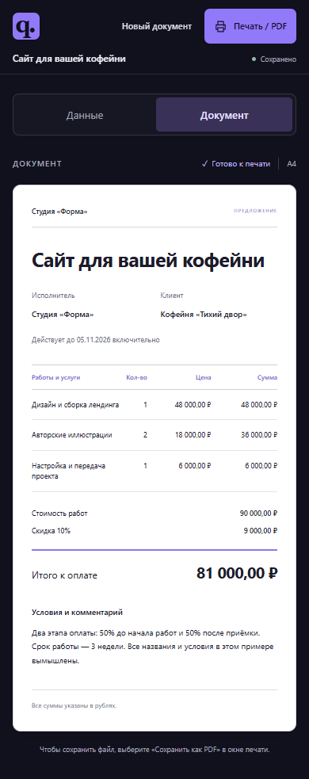
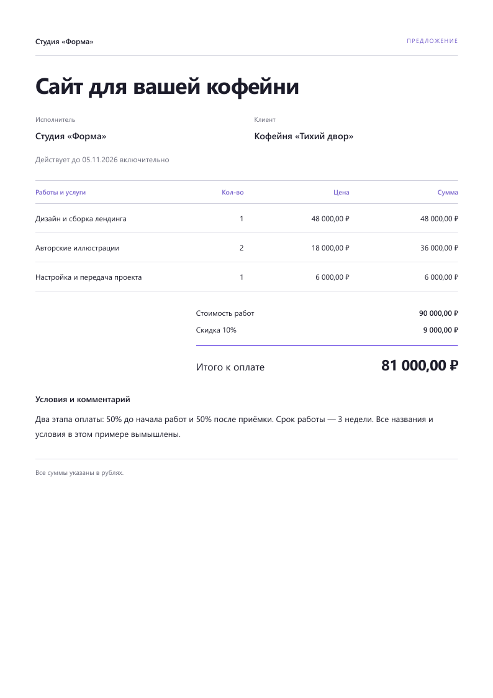

# Quote Builder

Конструктор коммерческих предложений с живым предпросмотром и точными расчётами в рублях. Заполните работы, стоимость и условия — получите документ для клиента и сохраните его в PDF через печать браузера.

**HTML · CSS · JavaScript · Node.js 24 · Без зависимостей · [MIT](LICENSE)**

## Что умеет

- Реквизиты исполнителя и клиента, название, срок действия и комментарий.
- До 200 позиций с автоматическим пересчётом строк и общей скидки.
- Цены с точкой или запятой, бесплатные позиции, скидка от 0 до 100%.
- Точные расчёты в целых копейках, корректное округление и защита от переполнения.
- Один черновик с автосохранением; незавершённый ввод не теряется после перезагрузки.
- Полный предпросмотр и единый документ для печати на одном или нескольких листах A4.
- На телефоне — вкладки «Данные / Документ»; клавиатурная навигация и переход к ошибочному полю.
- Пример доступен только в пустом состоянии и не перезаписывает пользовательскую смету.

Интерфейс на русском языке. Все данные остаются в браузере; приложение не обращается к внешним сервисам.

## Запуск

Нужен **Node.js 24 или новее**. Откройте терминал в папке проекта:

~~~sh
npm start
~~~

Откройте **[http://127.0.0.1:4174](http://127.0.0.1:4174)**. Остановка — Ctrl+C в терминале.

**npm install не требуется.** Локальный HTTP-сервер использует только встроенные модули Node.js и слушает 127.0.0.1. Открытие index.html через file:// не поддерживается из-за ES-модулей.

## Попробовать

1. В пустом документе нажмите **«Заполнить пример»**.
2. Смета вымышленных студии «Форма» и кофейни «Тихий двор»: 48 000 + 2 × 18 000 + 6 000 = **90 000 ₽**. Скидка 10% даёт **81 000 ₽**.
3. Добавьте позицию с количеством 3 и ценой 10,05. Итог станет **81 027,13 ₽**.
4. Перезагрузите страницу — черновик восстановится.
5. Проверьте документ и нажмите **«Печать / сохранить PDF»**. В диалоге браузера выберите «Сохранить как PDF». Для чистого документа отключите браузерные колонтитулы.

«Новый документ» очищает сохранение после подтверждения, если есть введённые данные. Комментарий необязателен; остальные реквизиты и хотя бы одна корректная позиция нужны для печати.

## Мобильный интерфейс

| Данные | Документ |
| --- | --- |
|  |  |

[Полный desktop](docs/screenshots/desktop-full.png) · [Экран 320 px](docs/screenshots/mobile-320.png)

## Печать

Демосмета помещается на одном листе A4. Предложение с 50 длинными позициями и большим комментарием проверено на пяти страницах: заголовки таблицы повторяются, строки, итог и конец комментария сохраняются.

[Первая страница длинного предложения](docs/screenshots/print-multipage-first.png) · [Последняя страница](docs/screenshots/print-multipage-last.png)

Печатный PDF формирует браузер. Серверного PDF-генератора нет. Экранный предпросмотр непрерывный; точные границы страниц определяются при печати.

## Точные расчёты

Цена разбирается как десятичная строка: 12,34 → 1234 копейки. Отрицательные значения, экспонента и дробные копейки отклоняются. Умножение, суммирование и скидка используют BigInt; перед преобразованием проверяется безопасный диапазон.

Скидка округляется **один раз от общей суммы**, до ближайшей копейки, половина — вверх. Например, скидка 12,5% на 30,15 ₽ составляет 3,77 ₽; итог — 26,38 ₽.

Максимальная цена, сумма строки и сумма до скидки — **90 071 992 547 409,91 ₽**. Переполнение показывает ошибку и блокирует печать. Неверный или незавершённый денежный ввод отображается как «—», а не как нулевая стоимость.

## Тесты

~~~sh
npm test
~~~

Встроенный node:test проверяет расчёты, округление, валидацию, переполнение, черновик, защиту примера, модель документа и HTTP-сервер. Зависимости для тестов не нужны.

GitHub Actions настроен на Node.js 24 в Linux и Windows. Workflow выполняет npm test без установки пакетов. Состояние серверных проверок доступно по бейджу Tests; локальные проверки и браузерная приёмка описаны в [TESTING.md](docs/TESTING.md).

## Ограничения

- Только рубли и одна общая скидка. Нет налогов, дополнительных валют, каталогов клиентов, подписей и отправки писем.
- Черновик хранится в localStorage текущего origin. Другой браузер, профиль, порт или localhost вместо 127.0.0.1 используют отдельное хранилище.
- Очистка данных браузера удаляет черновик. Между вкладками синхронизации нет; последнее сохранение заменяет предыдущее.
- При отказе хранилища работа продолжается с видимым предупреждением; несохранённые данные доступны только в открытой странице.
- Проверено в Edge/Chromium на Windows и touch-эмуляции 320–1440 px. Физические телефоны, Firefox/Safari, системное сохранение PDF и принтер не проверялись.

## Устройство проекта

~~~text
index.html                 форма и оболочка
styles.css                 адаптивный интерфейс и печатные стили
src/quote.js               расчёты, черновик, валидация и модель документа
src/app.js                 редактор, вкладки и общий DOM просмотра/печати
server.js                  локальный HTTP-сервер с явным списком ресурсов
tests/                     проверки через node:test
docs/DESIGN.md             визуальный ориентир и происхождение ассетов
docs/TESTING.md            проверенные сценарии и ограничения приёмки
docs/screenshots/          реальные снимки приложения с вымышленными данными
.github/workflows/test.yml  автоматические тесты
~~~

## Оформление и лицензия

Визуальный ориентир — [Invoify](https://invoify.vercel.app/en): тёмная оболочка, фиолетовый акцент и белый документ. Код, компоненты, шрифты и изображения источника не переносились. Используются собственные SVG и системные шрифты. Подробности — в [DESIGN.md](docs/DESIGN.md).

Исходный код распространяется по [лицензии MIT](LICENSE).
